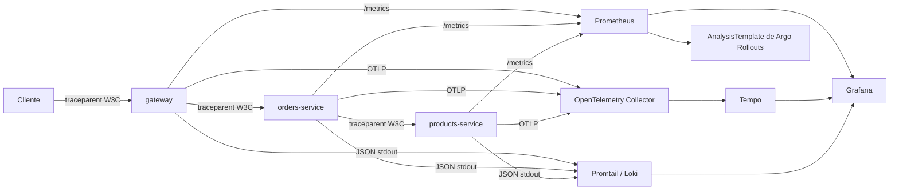

# Práctica 10 — Observabilidad y operación

Entrega de **202203069**. La solución extiende el flujo de P8/P9 sin crear otro proyecto GCP ni habilitar una cuenta de pago. Todo el stack se reconcilia con Argo CD en el clúster existente y P9 conserva sus respaldos, secretos externos, políticas y recuperación.

## 4.1 Datos de la entrega

| Campo | Valor |
|---|---|
| Repositorio de código | https://github.com/Carbonell-Castillo/Practicas-SA-B-202203069 |
| Repositorio GitOps | https://github.com/Carbonell-Castillo/Practicas-SA-B-202203069-gitops |
| Servicios instrumentados | `gateway`, `orders-service`, `products-service` en `sa-p9-prod` |
| Stack | Prometheus + Alertmanager, Grafana, Loki + Promtail, Tempo y OpenTelemetry Collector en `observabilidad` |
| Rollout por métricas | `orders-service` |
| SLO 1 | Disponibilidad ≥ 99.5 %, ventana móvil de 30 días |
| SLO 2 | 95 % de solicitudes en ≤ 750 ms, ventana móvil de 30 días |
| Tablero | `dashboards/p10-golden-signals.json` |
| Informe | `INFORME_OPERACION.md` |
| Video | Pendiente de colocar URL antes de la entrega en UEDI |

## Arquitectura y correlación



OpenTelemetry auto-instrumenta Express/Nest/Axios/FastAPI/SQLAlchemy. El propagador `tracecontext,baggage` extrae e inyecta `traceparent`, y cada registro JSON agrega `trace_id`; Grafana enlaza ese campo de Loki a Tempo.

## SLO, SLI y presupuesto de error

El SLO de disponibilidad de 99.5 % admite 0.5 % de respuestas fallidas (aprox. 3 h 36 min en 30 días). Es deliberadamente más exigente que una plataforma académica, pero deja margen para mantenimientos. El SLI `slo:http_availability:ratio_rate5m` mide respuestas no 5xx sobre el total percibido en los tres servicios.

El SLO de latencia exige p95 ≤ 750 ms durante 30 días. El umbral conserva una experiencia interactiva razonable aun cuando la orden cruza tres servicios y dos bases de datos. `slo:http_latency_p95:seconds_rate5m` y las reglas `slo:*error_budget:consumed_ratio_1h` materializan ambos indicadores y su presupuesto consumido.

Las alertas son de burn rate, no de un pico instantáneo, y enlazan a [availability-burn.md](runbooks/availability-burn.md) y [latency-burn.md](runbooks/latency-burn.md).

## Operación y demostración

La fuente de verdad está en `argocd/apps/02-observability.yaml` y `charts/p10-observability` del repositorio GitOps. El tablero cubre tráfico, errores, latencia, saturación, las dos métricas de negocio y presupuesto de error.

Para validar desde Git Bash:

```bash
cd '/d/bccas/USAC/SA/Practicas SA/P10'
chmod +x verificar_p10.sh
./verificar_p10.sh
```

Consulte [PRUEBAS.md](PRUEBAS.md) para la prueba end-to-end, búsqueda por traza y demostración de rollback.
