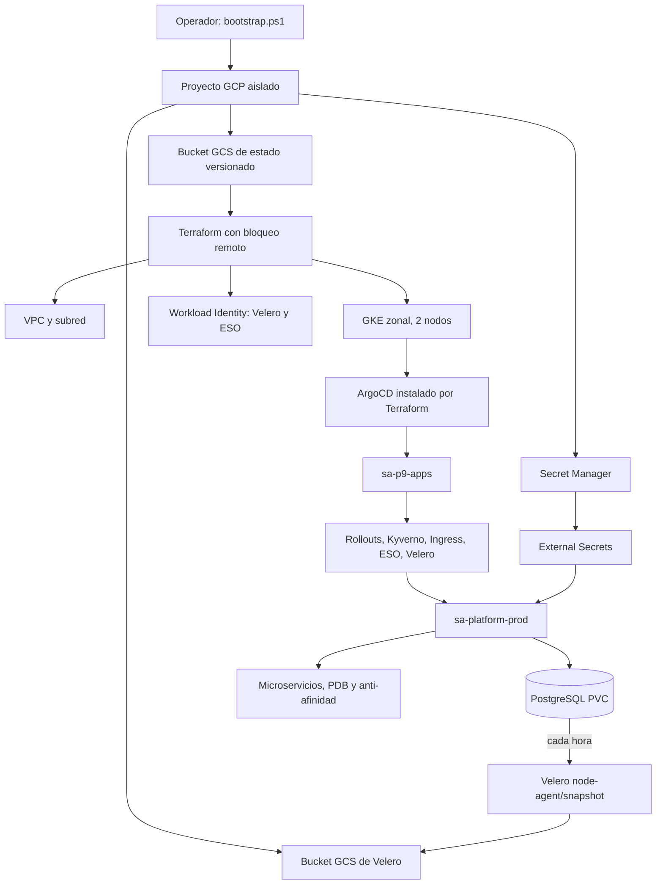

# Diagrama del bootstrap y dependencias

Las únicas precondiciones manuales son autenticar `gcloud` y disponer de una cuenta de créditos existente. Desde ahí, el script crea o verifica almacenamiento externo, secretos, Terraform, ArgoCD y GitOps sin pasos manuales intermedios. Los buckets y Secret Manager tienen un ciclo de vida independiente del clúster para que sigan disponibles durante la recuperación.
